# AtmoSync

Cold-chain container telemetry pipeline for validating, storing, and verifying refrigerated shipping sensor data (`temperature_c`, `humidity_pct`, `vibration_g`) in PostgreSQL.

## Problem Statement and Project Objective

Monitoring environmental conditions during agricultural cold-chain transportation is critical because gradual cooling drift, humidity swings, or excessive transit vibration can degrade perishable produce before arrival. AtmoSync addresses this by providing an end-to-end data engineering pipeline that ingests, validates, streams, transforms, and visualizes container telemetry (`temperature_c`, `humidity_pct`, `vibration_g`) across shipping routes.

The pipeline combines idempotent batch CSV loading and real-time Apache Kafka streaming into PostgreSQL, dbt Core analytics models for statistical baseline drift detection (`|z-score| >= 2.0`), and an Apache Superset dashboard for interactive container health monitoring.

## Prerequisites

- **Operating System:** Windows 10 / 11
- **Python:** Python 3.12 (separate `.venv` for ingestion/Kafka and `.venv-dbt` for dbt Core)
- **Version Control:** Git
- **Container Runtime:** Docker Desktop with WSL2 backend
- **Database Client (optional):** DBeaver Community
- **Running Core Services:** Existing PostgreSQL 16 (`atmosync-postgres` on `127.0.0.1:5432`) and Apache Kafka (`data_engineering/docker-compose.yml`, KRaft mode on `127.0.0.1:9092`)
- **BI Platform:** Apache Superset (`dashboard_visualization/docker-compose.superset.yml` on `127.0.0.1:8088`)

## Project Structure

- `generate_data.py` — Synthetic telemetry generator for 5 refrigerated containers (`C001`–`C005`).
- `sensor_readings.csv` — Baseline 240-row hourly telemetry dataset (`48` hours × `5` containers).
- `requirements.txt`, `requirements-dbt.txt` — Python dependencies for `.venv` and isolated `.venv-dbt`.
- `data_engineering/` — Data ingestion, PostgreSQL schema, Kafka streaming, and Python test suite:
  - `data_engineering/sql/001_add_constraints_and_indexes.sql` — Non-destructive migration adding `UNIQUE (container_id, timestamp_utc)` and a composite time-series index to `public.sensor_readings`.
  - `data_engineering/atmosync/config.py`, `db.py` — Environment configuration loader (`.env` / `PG*` / `DATABASE_URL`) and PostgreSQL connection helper.
  - `data_engineering/atmosync/ingest.py`, `validate.py` — Strict CSV schema/type validator, idempotent `ON CONFLICT DO NOTHING` loader, and post-ingestion checks.
  - `data_engineering/atmosync/kafka_config.py`, `kafka_topics.py`, `producer.py`, `consumer.py` — Kafka configuration, topic provisioning, independent producer, and DLQ-enabled consumer committing offsets only after DB success.
  - `data_engineering/docker-compose.yml` — Standalone Apache Kafka `3.9.0` (KRaft mode, no ZooKeeper) container definition.
  - `data_engineering/tests/test_ingestion.py`, `test_kafka_pipeline.py` — `pytest` suites covering Phase 1 and Phase 2.
- `dbt_transformations/` — dbt Core transformation project (`staging`, `intermediate`, `marts`), env-var-driven `profiles.yml`, `run_dbt.py` `.env` loader, macros, and data quality tests.
- `dashboard_visualization/` — Single-container Apache Superset `4.1.1` deployment (`Dockerfile.superset`, `docker-compose.superset.yml`, `superset_config.py`, `setup_superset.py`, `create_dashboard.py`).
- `screenshots/` — Project architecture, Apache Superset dashboard/chart captures, PostgreSQL, dbt, and Kafka verification screenshots.

## Project Screenshots & Demonstration

### 1. System Architecture
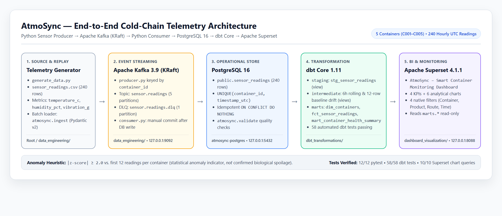
*End-to-end telemetry architecture connecting Python ingestion and Apache Kafka (KRaft) streaming to PostgreSQL 16, dbt Core transformations, and Apache Superset.*

### 2. Apache Superset Dashboard & Telemetry Visualizations
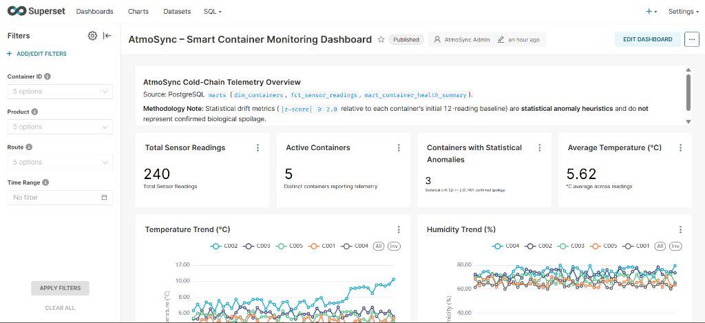
*`AtmoSync – Smart Container Monitoring Dashboard` showing native dashboard filters (`Container ID`, `Product`, `Route`, `Time Range`), methodology disclaimer, and KPI cards (`240` readings, `5` active containers, `3` containers with statistical drift anomalies, `5.62 °C` average temperature).*

# 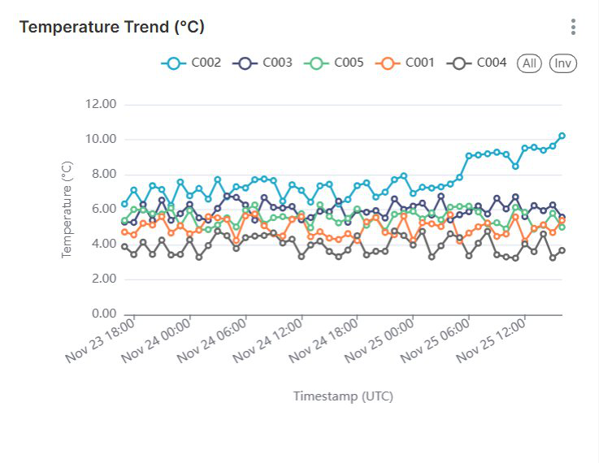
 *Hourly temperature trend (`°C`) across `C001`–`C005` showing `C002` (`tomato`, `Nashik-Delhi`) drifting upward to `10.22 °C`.*

# 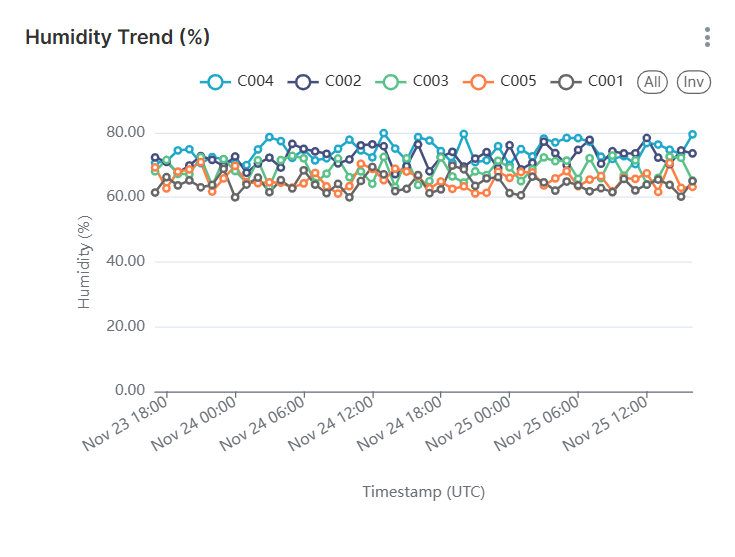
 *Hourly relative humidity (`%`) comparison across all five refrigerated shipping containers.*

# 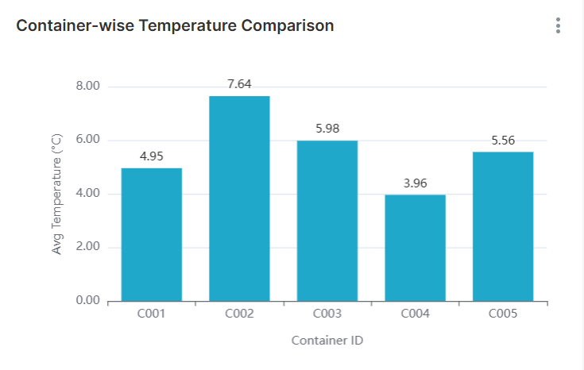
*Average temperature (`°C`) per container, highlighting elevated mean temperature on `C002` (`7.64 °C`).*

# 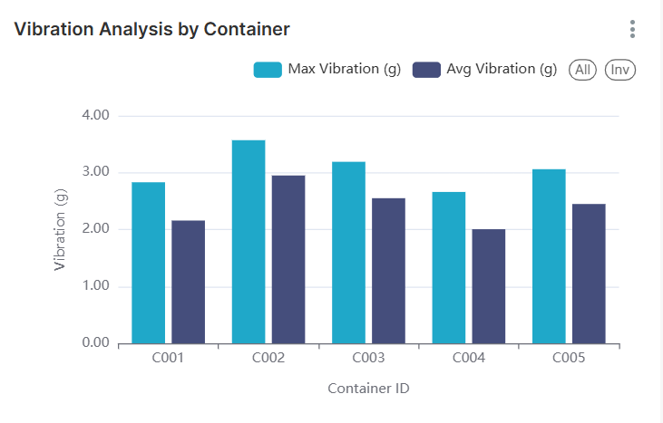
*Average and maximum vibration (`g`) across `C001`–`C005`.*

### 3. Statistical Anomaly Analysis & Container Health Summary
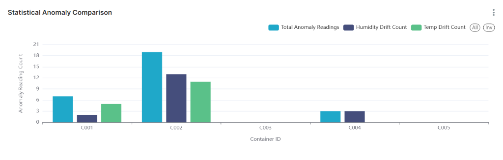
*Counts of readings exceeding `|z-score| >= 2.0` relative to each container's initial 12-reading baseline (`C002`: `19`, `C001`: `7`, `C004`: `3`). Statistical drift indicators only — not confirmed biological spoilage.*

# 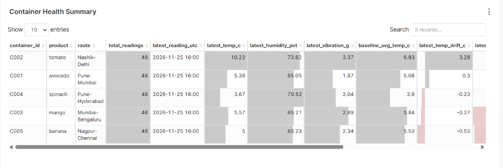
*`marts.mart_container_health_summary` table view showing container metadata (`product`, `route`), `total_readings` (`48` each), and latest telemetry.*

# 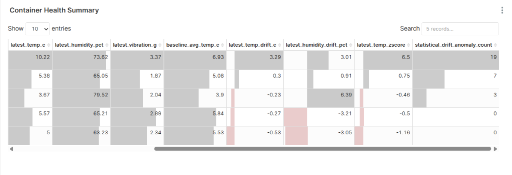
*`marts.mart_container_health_summary` drift columns showing `baseline_avg_temp_c`, `latest_temp_drift_c`, `latest_humidity_drift_pct`, `latest_temp_zscore`, and `statistical_drift_anomaly_count`.*

### 4. PostgreSQL, dbt Core & Apache Kafka Verification
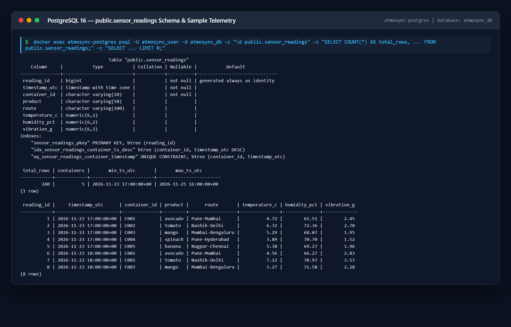
*PostgreSQL 16 `public.sensor_readings` table schema, `UNIQUE(container_id, timestamp_utc)` constraint, `240` total rows across `5` containers, and sample telemetry records.*

# 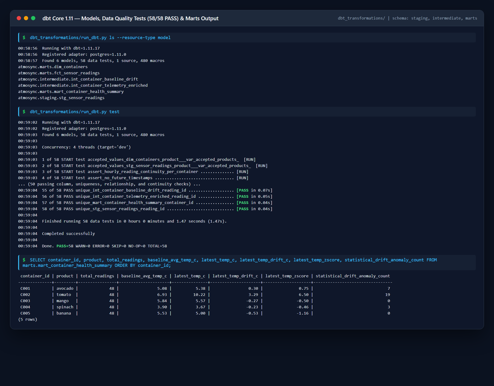
*dbt Core 1.11 model inventory (`staging`, `intermediate`, `marts`), `58/58` passing data quality tests, and `marts.mart_container_health_summary` query output.*

# 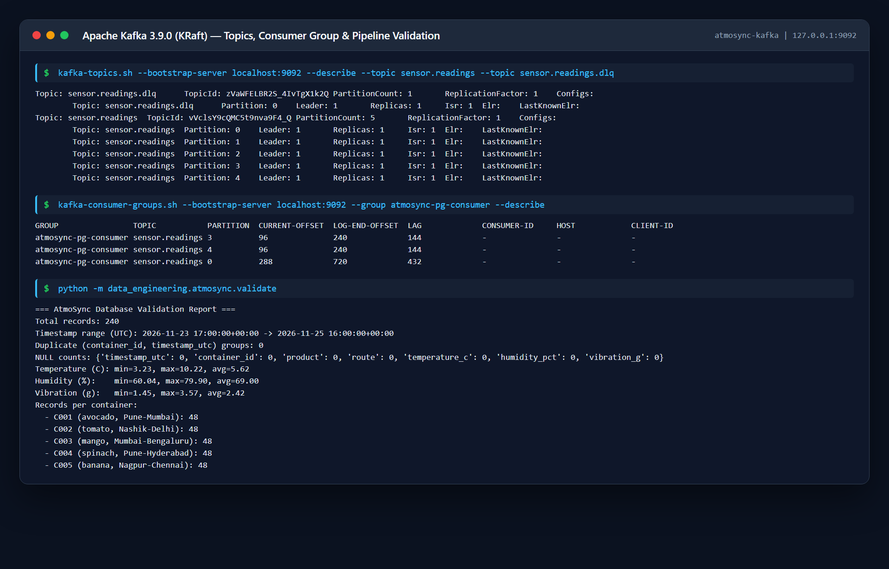
*Apache Kafka 3.9.0 (KRaft) topic partitions (`sensor.readings` 5 partitions, `sensor.readings.dlq` 1 partition), consumer group offsets, and `data_engineering.atmosync.validate` output.*

## Setup (Python 3.12)

1. Create and activate the Python 3.12 virtual environment:

   ```powershell
   py -3.12 -m venv .venv
   .\.venv\Scripts\Activate.ps1
   pip install -r requirements.txt
   ```

2. Configure database credentials locally (never commit `.env`):

   ```powershell
   Copy-Item .env.example .env
   ```

   Edit `.env` with your local `PGHOST`, `PGPORT`, `PGDATABASE`, `PGUSER`, and `PGPASSWORD` (or `DATABASE_URL`) for the existing `atmosync-postgres` instance (`127.0.0.1:5432`, `atmosync_db`, `atmosync_user`).

3. Apply the non-destructive schema constraints and time-series index (if not already applied):

   ```powershell
   Get-Content data_engineering\sql\001_add_constraints_and_indexes.sql -Raw | docker exec -i atmosync-postgres psql -v ON_ERROR_STOP=1 -U atmosync_user -d atmosync_db
   ```

## Usage

### Ingest CSV Data

Validates all 7 columns (`timestamp_utc`, `container_id`, `product`, `route`, `temperature_c`, `humidity_pct`, `vibration_g`), normalizes timestamps to UTC, rejects invalid rows, and inserts into `public.sensor_readings` with `ON CONFLICT (container_id, timestamp_utc) DO NOTHING`:

```powershell
.\.venv\Scripts\python.exe -m data_engineering.atmosync.ingest --csv sensor_readings.csv
```

### Validate Database Contents

Runs post-ingestion checks (total rows, per-container counts, UTC timestamp bounds, NULL counts, duplicate key checks, and numeric ranges):

```powershell
.\.venv\Scripts\python.exe -m data_engineering.atmosync.validate
```

### Run Tests

```powershell
.\.venv\Scripts\python.exe -m pytest -v data_engineering/tests
```

## Phase 2: Apache Kafka (KRaft) Streaming Pipeline

Architecture: `Python Sensor Producer → Apache Kafka (KRaft) → Python Consumer → PostgreSQL`

1. Start Apache Kafka `3.9.0` (KRaft mode; leaves the existing `atmosync-postgres` container and `atmosync_pgdata` volume untouched):

   ```powershell
   docker compose --env-file .env -f data_engineering/docker-compose.yml up -d --wait
   ```

2. Create the Kafka topics (`sensor.readings` with 5 partitions, `sensor.readings.dlq` with 1 partition):

   ```powershell
   .\.venv\Scripts\python.exe -m data_engineering.atmosync.kafka_topics
   ```

3. Run the Kafka consumer (reads from `sensor.readings`, routes invalid payloads to `sensor.readings.dlq`, persists valid records idempotently into PostgreSQL, and commits offsets only after DB transaction success):

   ```powershell
   .\.venv\Scripts\python.exe -m data_engineering.atmosync.consumer
   ```

4. In a separate terminal, run the Kafka producer (replay `sensor_readings.csv` safely without creating DB duplicates, or stream live readings):

   ```powershell
   .\.venv\Scripts\python.exe -m data_engineering.atmosync.producer --mode csv --csv sensor_readings.csv
   # Or stream live synthetic batches:
   .\.venv\Scripts\python.exe -m data_engineering.atmosync.producer --mode live --ticks 3 --interval 1.0
   ```

## Phase 3: dbt Core Transformations (`staging` → `intermediate` → `marts`)

Lineage: `public.sensor_readings` (preserved read-only) → `staging` (views) → `intermediate` (views) → `marts` (tables) → Apache Superset.

### 1. Isolated dbt Virtual Environment (`.venv-dbt`)

Keep `.venv` dedicated to ingestion/Kafka and install dbt Core into `.venv-dbt`:

```powershell
py -3.12 -m venv .venv-dbt
.\.venv-dbt\Scripts\python.exe -m pip install -r requirements-dbt.txt
```

### 2. Safe `.env` Loading & `profiles.yml`

`dbt_transformations/profiles.yml` uses `env_var()` (`PGHOST`, `PGPORT`, `PGUSER`, `PGPASSWORD`, `PGDATABASE`) with no hardcoded credentials. Because dbt Core does not automatically read `.env`, use the wrapper script `dbt_transformations/run_dbt.py` (which loads `.env` into the child process environment without printing secrets):

```powershell
.\.venv-dbt\Scripts\python.exe dbt_transformations\run_dbt.py debug
.\.venv-dbt\Scripts\python.exe dbt_transformations\run_dbt.py parse
.\.venv-dbt\Scripts\python.exe dbt_transformations\run_dbt.py run
.\.venv-dbt\Scripts\python.exe dbt_transformations\run_dbt.py test
```

### 3. Models & Statistical Logic

- `staging.stg_sensor_readings` (view): standardized 1:1 view over `public.sensor_readings` with UTC date/hour buckets and split `origin_city` / `destination_city`.
- `intermediate.int_container_telemetry_enriched` (view): per-container sequence numbers, 1-hour deltas (`temp_delta_1h`, `humidity_delta_1h`, `vibration_delta_1h`), and trailing 6-reading moving averages (assuming hourly cadence).
- `intermediate.int_container_baseline_drift` (view): compares readings against each container's initial baseline window (default first `12` readings via `baseline_window_readings`). Uses `NULLIF(stddev, 0)` to guard against zero-variance division and flags `|z-score| >= 2.0` (`drift_zscore_cutoff`) as **`is_statistical_drift_anomaly`** — explicitly a **statistical anomaly heuristic, NOT confirmed spoilage**.
- `marts.dim_containers` (table): one row per container (`C001`–`C005`).
- `marts.fct_sensor_readings` (table): fact table at grain `(container_id, timestamp_utc)`.
- `marts.mart_container_health_summary` (table): per-container KPIs, latest values, baseline drift, peak `|z-score|`, and anomaly counts.

Override defaults via dbt `--vars`, for example:

```powershell
.\.venv-dbt\Scripts\python.exe dbt_transformations\run_dbt.py run --vars '{"baseline_window_readings": 12, "drift_zscore_cutoff": 2.0}'
```

### 4. Data Quality & Monitoring Tests

- Schema tests: `unique`, `not_null`, composite `unique_combination` on `(container_id, timestamp_utc)`, `accepted_values` on `product` (configurable via `accepted_products`), and `relationships` from `fct_sensor_readings` and `mart_container_health_summary` to `dim_containers`.
- Singular tests: `assert_no_future_timestamps` (error) and `assert_hourly_reading_continuity_per_container` (`severity: warn` monitoring check).

### 5. Apache Superset Connection

Connect Apache Superset to PostgreSQL using:
- **SQLAlchemy URI host/port:** `127.0.0.1:5432` (or `host.docker.internal:5432` if Superset runs inside Docker)
- **Database:** `atmosync_db`
- **Target Schema:** `marts` (`dim_containers`, `fct_sensor_readings`, `mart_container_health_summary`)

## Phase 4: Apache Superset Dashboard Platform

Single-container Apache Superset `4.1.1` deployment (1 Gunicorn worker, 4 threads, `1280m` memory limit, no Celery/Redis), bound strictly to `127.0.0.1:8088` with persistent metadata stored in named volume `atmosync_superset_home`.

1. Ensure `.env` contains `SUPERSET_SECRET_KEY`, `SUPERSET_ADMIN_USERNAME`, `SUPERSET_ADMIN_FIRSTNAME`, `SUPERSET_ADMIN_LASTNAME`, `SUPERSET_ADMIN_EMAIL`, and `SUPERSET_ADMIN_PASSWORD` (see [.env.example](.env.example); never commit `.env`).

2. Build and start Superset independently of Kafka and PostgreSQL:

   ```powershell
   docker compose --env-file .env -f dashboard_visualization/docker-compose.superset.yml up -d --build --wait
   ```

3. Initialize metadata, create the admin user, verify `/health`, test PostgreSQL connectivity via `host.docker.internal:5432`, and register the `marts` datasets (`dim_containers`, `fct_sensor_readings`, `mart_container_health_summary`):

   ```powershell
   .\.venv\Scripts\python.exe dashboard_visualization\setup_superset.py --pg-host host.docker.internal
   ```

4. Access Superset locally at `http://127.0.0.1:8088` using the admin credentials in `.env`. To verify metadata persistence after a restart:

   ```powershell
   docker compose --env-file .env -f dashboard_visualization/docker-compose.superset.yml restart
   .\.venv\Scripts\python.exe dashboard_visualization\setup_superset.py --pg-host host.docker.internal --verify-only
   ```

## Phase 5: Automated Superset Dashboard

Provision **AtmoSync – Smart Container Monitoring Dashboard** via the Superset REST API (`dashboard_visualization/create_dashboard.py`, idempotent):

```powershell
.\.venv\Scripts\python.exe dashboard_visualization\create_dashboard.py
```

- **KPI Charts:** `Total Sensor Readings` (`240`), `Active Containers` (`5`), `Containers with Statistical Anomalies` (`3`, statistical heuristic `|z-score| >= 2.0`, not confirmed spoilage), `Average Temperature (°C)` (`5.62`).
- **Analytical Charts:** `Temperature Trend (°C)`, `Humidity Trend (%)`, `Container-wise Temperature Comparison`, `Vibration Analysis by Container`, `Statistical Anomaly Comparison`, and `Container Health Summary`.
- **Native Filters:** `Container ID` (all charts), `Product` & `Route` (`mart_container_health_summary` charts), and `Time Range` (`fct_sensor_readings` charts).

## Limitations and Synthetic Data Disclaimer

- **Synthetic Dataset:** `sensor_readings.csv` contains 240 simulated hourly readings across five containers (`C001`–`C005`, 48 readings each) generated by `generate_data.py` for software testing and demonstration.
- **No Physical Hardware:** No physical IoT sensors or live transport hardware are connected to this pipeline.
- **Statistical Heuristic Only:** Anomaly detection compares each reading against an initial 12-reading baseline window per container using `|z-score| >= 2.0`. Statistical drift flags indicate anomalous sensor deviation and do **not** establish confirmed food spoilage or biological degradation.
- **Dashboard Filter Scope:** Due to normalized star-schema dataset relationships (`marts.fct_sensor_readings` does not duplicate `product` or `route` attributes), `Product` and `Route` native filters apply only to `mart_container_health_summary` summary charts, whereas `Container ID` filters all 10 charts.
- **Local Development Superset Setup:** Superset runs in a single container (`1` Gunicorn worker) with an embedded SQLite metadata database (`atmosync_superset_home`), which is sized for local development/evaluation rather than multi-user production deployment.

## Contributions & Credits

### Vignesh – Dashboard & Data Visualization

- Apache Superset dashboard development (`AtmoSync – Smart Container Monitoring Dashboard`).
- Dashboard layout and configuration (KPI row, time-series trend row, container comparison rows, health summary table, and methodology disclaimer).
- Data visualization and chart development (4 KPI cards, 2 time-series line charts, 3 comparison bar charts, and 1 health summary table).
- Dashboard filters and interactive functionality (native filters for Container ID, Product, Route, and Time Range).
- Visual presentation of container telemetry (`temperature_c`, `humidity_pct`, `vibration_g`) and statistical anomaly metrics.
- Original synthetic dataset and data-generation script (`sensor_readings.csv` and `generate_data.py`).

---

### Sania Maheen – Data Engineering, Streaming & Integration

- Python-based sensor data ingestion (`data_engineering/atmosync/ingest.py`, schema/type validation, UTC normalization).
- PostgreSQL database setup, schema hardening, unique constraints, and time-series indexing (`data_engineering/sql/001_add_constraints_and_indexes.sql`).
- Apache Kafka (KRaft) integration and topic provisioning (`data_engineering/docker-compose.yml`, `data_engineering/atmosync/kafka_config.py`, `data_engineering/atmosync/kafka_topics.py`).
- Real-time streaming pipeline using independent Kafka producer and consumer (`data_engineering/atmosync/producer.py`, `data_engineering/atmosync/consumer.py`) with Dead Letter Queue (DLQ) routing.
- Duplicate handling and idempotent ingestion (`ON CONFLICT DO NOTHING` and manual Kafka offset commits after PostgreSQL transactions).
- Data validation and automated testing (`data_engineering/atmosync/validate.py`, `data_engineering/tests/test_ingestion.py`, `data_engineering/tests/test_kafka_pipeline.py`).
- dbt Core setup and SQL data transformations (`dbt_transformations/`).
- Staging, intermediate, and mart models (`stg_sensor_readings`, `int_container_telemetry_enriched`, `int_container_baseline_drift`, `dim_containers`, `fct_sensor_readings`, `mart_container_health_summary`) plus dbt quality tests.
- Statistical baseline and anomaly-detection logic (initial 12-reading baseline per container and `|z-score| >= 2.0` heuristic flagging).
- End-to-end integration of Python, Apache Kafka, PostgreSQL, and dbt Core, along with independent completion of all backend integration tasks.
- Project testing, pipeline validation, troubleshooting, and technical documentation.

---
